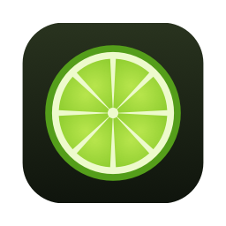
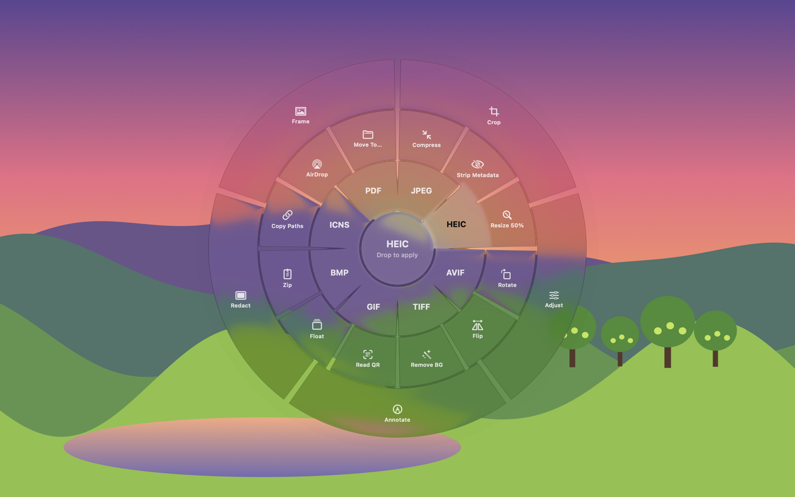
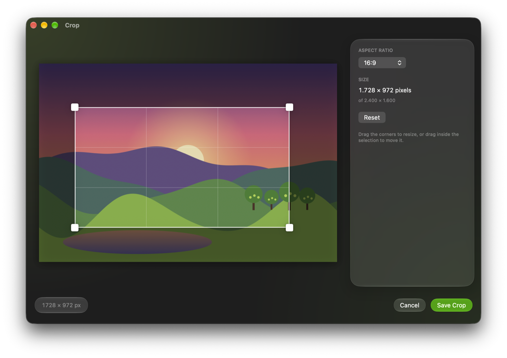
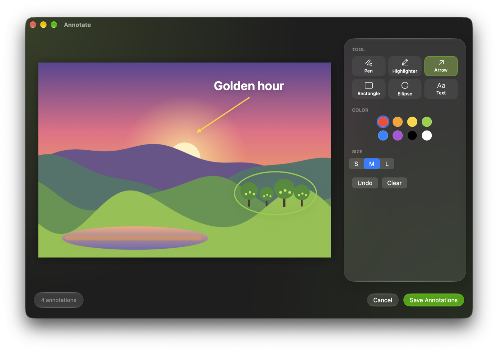
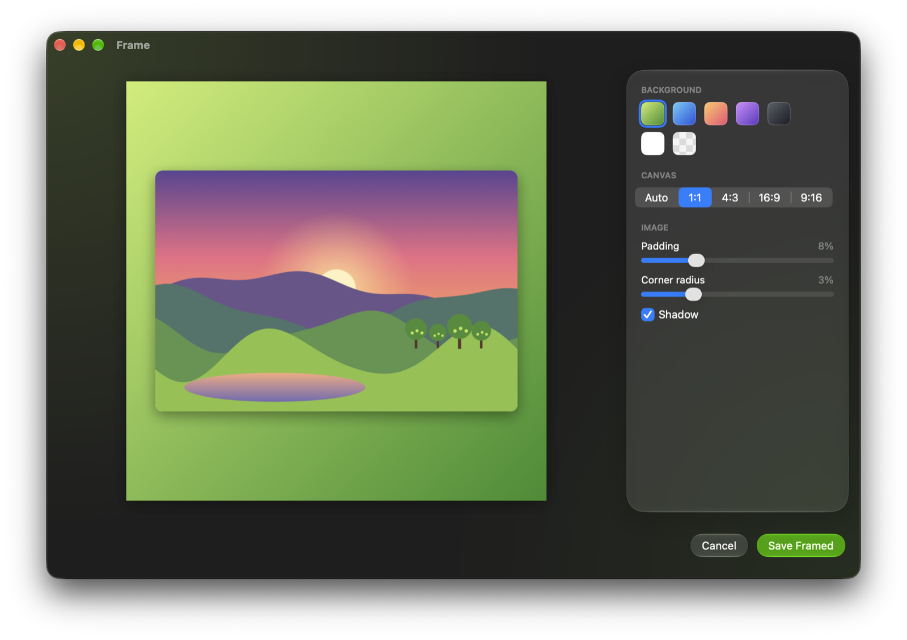
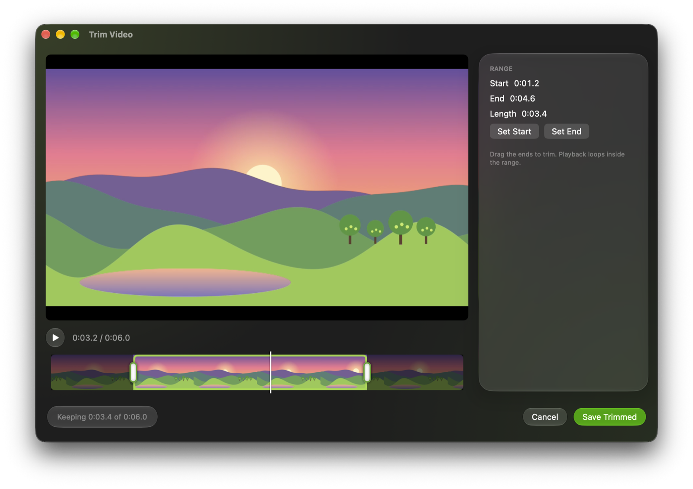
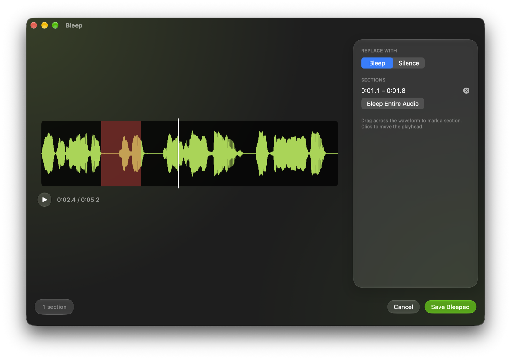
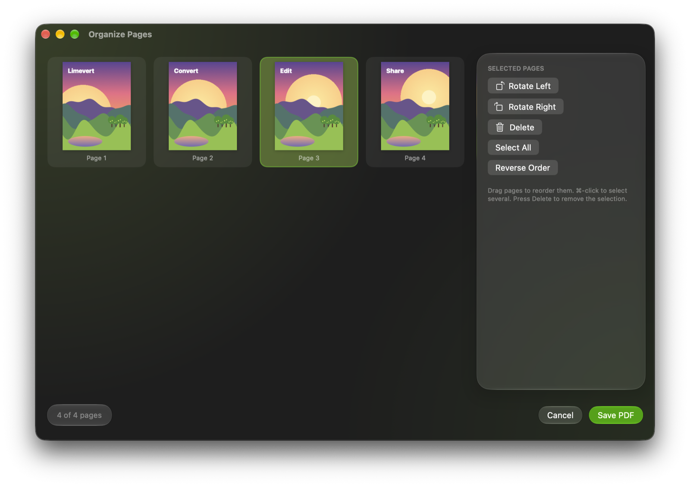
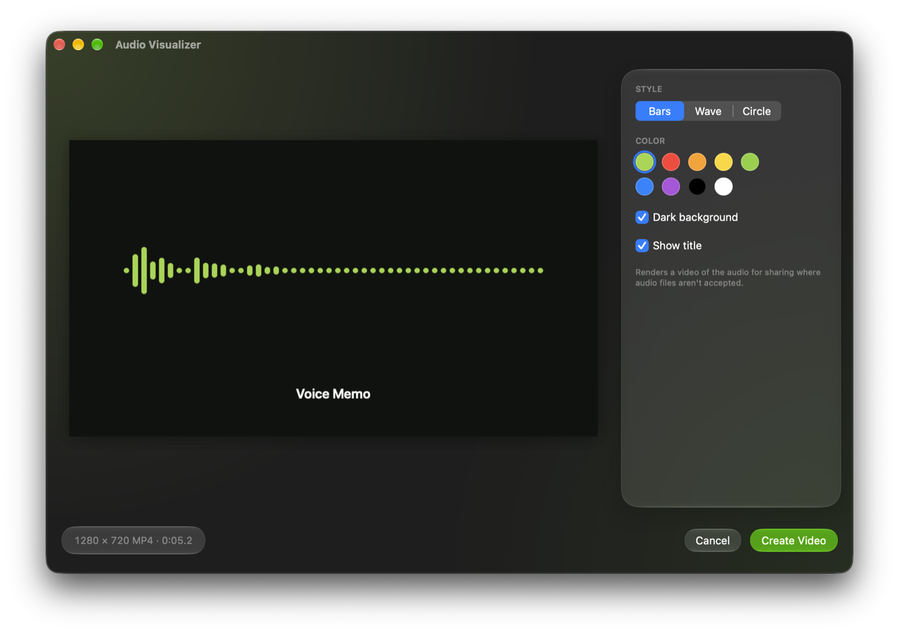
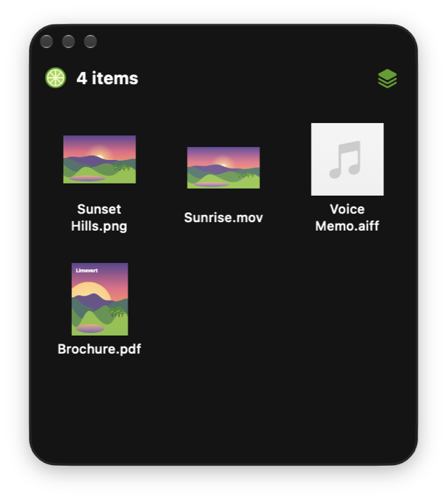

<p align="center">
  
</p>

<h1 align="center">Limevert</h1>

<p align="center">
  <strong>Convert, edit and carry files without opening another app.</strong><br>
  A free, open-source menu bar tool for macOS.
</p>

<p align="center">
  <a href="https://github.com/LootCharity/Limevert/releases/latest"></a>
  
  
  <a href="LICENSE"></a>
</p>

<p align="center">
  <a href="https://github.com/LootCharity/Limevert/releases/latest"><strong>⬇&nbsp;&nbsp;Download Limevert for Mac</strong></a>
</p>

<picture>
  <source media="(prefers-color-scheme: light)" srcset="docs/images/wheel-light.png">
  
</picture>

## Drag. Tap ⌥. Drop.

1. **Start dragging** any file — from Finder, the Desktop, Mail, a browser.
2. **Tap ⌥ Option** while you drag. A wheel of formats and tools opens right under your pointer.
3. **Drop on a petal.** Limevert does the work in the background and saves the result next to the original.

No windows to open, no upload, no waiting. You can also drop files on the lime in the menu bar, or choose **Convert Files…** from its menu.

## Edit without opening another app

Some tools open a small editor first. Each one saves a new file and never touches your original.

<table>
  <tr>
    <td width="50%"></td>
    <td width="50%"></td>
  </tr>
  <tr>
    <td><b>Crop</b> to any aspect ratio, with the exact pixel size shown as you drag.</td>
    <td><b>Annotate</b> with pens, highlighter, arrows, shapes and text.</td>
  </tr>
  <tr>
    <td></td>
    <td></td>
  </tr>
  <tr>
    <td><b>Frame</b> screenshots and photos on gradients, with padding, rounded corners and a shadow.</td>
    <td><b>Trim</b>, split or speed up videos, and save single frames as pictures.</td>
  </tr>
  <tr>
    <td></td>
    <td></td>
  </tr>
  <tr>
    <td><b>Bleep</b> or mute parts of a recording, or trim it — silence at the ends goes with one click.</td>
    <td><b>Organize</b> PDF pages: drag to reorder, rotate or delete.</td>
  </tr>
</table>

There's more: **Adjust** (exposure, contrast, highlights, shadows, warmth, sharpness), **Redact** (pixelate, blur or black out — with automatic face and text detection), **Collage**, and an **Audio Visualizer** that turns a voice memo into a shareable video.

<p align="center">
  
</p>

## Float: a shelf for your files



Collecting files from different places? Drop them on a **Float** — a small shelf that stays on top of every window and every Space. Drag them out again, one by one or all at once, wherever you need them.

Create one from the wheel or from the menu bar. Close it when you're done; your files stay where they were.

<br clear="right">

## Everything it can do

| Files | Convert to | Tools |
|---|---|---|
| **Images** | JPEG, PNG, HEIC, AVIF, TIFF, GIF, BMP, ICNS, PDF | Compress, strip metadata, resize, rotate, flip, remove background, read QR codes, combine into PDF · Crop, Adjust, Annotate, Redact, Frame, Collage |
| **Video** | MP4, MOV, M4V, animated GIF | Compress, strip metadata, extract audio, mute, join clips · Trim, Split, Speed, Snapshot |
| **Audio** | M4A, ALAC, WAV, AIFF, FLAC, CAF | Normalize, mono, stereo · Trim, Bleep, Visualizer |
| **PDF** | PNG or JPEG pages, TXT, RTF | Compress, merge, split into pages, strip metadata, read QR codes · Organize |
| **Documents** | DOCX, PDF, RTF, TXT, HTML, ODT, Markdown | |
| **Subtitles** | SRT ↔ VTT | |
| **Anything** | | Float, Zip/Unzip, Copy Paths, AirDrop, Move To…, open in Terminal |

**Private by design.** Everything runs on your Mac with Apple's built-in frameworks. No account, no uploads, no network access, no paid tier.

**Liquid Glass.** On macOS 26 and later, Limevert uses Apple's Liquid Glass design throughout. Prefer the classic look? Turn it off in **Settings → General → Appearance**.

## Install

1. [Download the latest `Limevert-<version>.dmg`](https://github.com/LootCharity/Limevert/releases/latest), open it and drag **Limevert** into **Applications**.
2. Open Limevert. Because this build isn't notarized by Apple, macOS says it can't verify the developer.
3. Go to **System Settings → Privacy & Security**, scroll down and click **Open Anyway**, then confirm. You only need to do this once.

Or, in Terminal: `xattr -dr com.apple.quarantine /Applications/Limevert.app`

**Requirements:** macOS 14 or later, on Apple silicon or Intel.

## Build from source

Needs only the Command Line Tools — no Xcode.

```sh
./build.sh                # builds ~/Library/Caches/Limevert-build/Limevert.app
./build.sh --install      # also copies it to /Applications
./release.sh              # universal build packaged as a DMG
```

## License

[MIT](LICENSE). Limevert is an independent project and isn't affiliated with any other app or company. The pictures in the screenshots are original illustrations made for this README.
